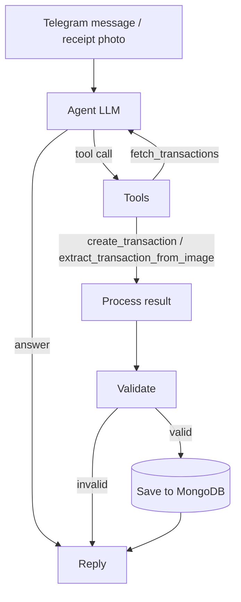

# 💼 AI Expense Tracker (Telegram + LangGraph)

A personal expense tracker you talk to on Telegram. Type an expense, send a receipt photo, or ask questions about your spending, and an AI agent (LangGraph + OpenAI) records it in MongoDB or analyzes your data.

## ✨ Features

- **Add expenses by text**: "I spent 500 on groceries", "Paid 2000 rent yesterday"
- **Add expenses from receipt photos**: the vision model reads the amount, date, purpose and category
- **Spending analysis**: monthly totals, category breakdown, highest expense, top category
- **Smart suggestions**: flags potentially controllable spending and suggests ways to save
- **Styled Telegram messages**: receipt-style cards, emojis, text charts and quick-action buttons
- **Private by design**: only your Telegram user ID can use the bot
- **Terminal mode**: test the agent without Telegram (`python cli.py`)

## 🧠 How it works



1. The agent decides which tool to call (or answers directly).
2. For a new expense, the result is parsed, validated (amount > 0, purpose present) and saved to MongoDB.
3. For analysis questions, the agent fetches transactions for the right date range and writes the report from that data only.

## 🧰 Tech stack

| Layer          | Technology                     |
| -------------- | ------------------------------ |
| Bot            | python-telegram-bot            |
| Agent workflow | LangGraph, LangChain           |
| LLM / vision   | OpenAI (default `gpt-4o-mini`) |
| Database       | MongoDB (pymongo)              |
| Validation     | Pydantic                       |

## 📁 Project structure

```
expense-tracker/
├── main.py              # run the Telegram bot
├── cli.py               # chat with the agent in the terminal
├── requirements.txt
├── .env.example
└── tracker/
    ├── config.py        # environment variables + logging
    ├── models.py        # TransactionCategory, Transaction
    ├── database.py      # MongoDB save / fetch (shared client)
    ├── llm.py           # ChatOpenAI instances
    ├── prompts.py       # agent system prompt + receipt prompt
    ├── tools.py         # LangChain tools
    ├── formatting.py    # Telegram HTML message design
    ├── agent/
    │   ├── state.py     # graph state + initial_state()
    │   ├── nodes.py     # agent, process, validate, save
    │   ├── routing.py   # conditional edges
    │   └── graph.py     # builds and compiles the graph
    └── bot/
        ├── app.py       # builds and runs the Telegram app
        └── handlers.py  # commands, messages, buttons
```

## 🚀 Getting started

### Prerequisites

- Python 3.10+
- A running MongoDB (local or [MongoDB Atlas](https://www.mongodb.com/atlas))
- An [OpenAI API key](https://platform.openai.com/api-keys)
- A Telegram bot token from [@BotFather](https://t.me/BotFather)
- Your Telegram numeric user ID (message [@userinfobot](https://t.me/userinfobot) to get it)

### Installation

```bash
git clone <your-repo-url>
cd expense-tracker

python -m venv .venv
source .venv/bin/activate        # Windows: .venv\Scripts\activate

pip install -r requirements.txt
cp .env.example .env             # then fill in your values
```

### Configuration (`.env`)

| Variable                   | Required | Default                     | Description                          |
| -------------------------- | -------- | --------------------------- | ------------------------------------ |
| `OPENAI_API_KEY`           | ✅       | -                           | OpenAI API key                       |
| `TELEGRAM_BOT_TOKEN`       | ✅ (bot) | -                           | Token from BotFather                 |
| `TELEGRAM_ALLOWED_USER_ID` | ✅ (bot) | -                           | Only this user can use the bot       |
| `MONGO_URI`                |          | `mongodb://localhost:27017` | MongoDB connection string            |
| `MONGO_DB_NAME`            |          | `telegram-rag`              | Database name                        |
| `MONGO_COLLECTION`         |          | `transactions`              | Collection name                      |
| `OPENAI_MODEL`             |          | `gpt-4o-mini`               | Must support tool calling and vision |
| `LOG_LEVEL`                |          | `INFO`                      | Python logging level                 |

### Run

```bash
python main.py     # start the Telegram bot
python cli.py      # or test in the terminal (no Telegram needed)
```

## 💬 Usage

| You send                              | What happens                                    |
| ------------------------------------- | ----------------------------------------------- |
| `I spent 500 on groceries`            | Expense is saved and a receipt card is shown    |
| 📸 a receipt photo (caption optional) | Details are extracted and saved                 |
| `Analyze my expenses this month`      | Summary with category breakdown and suggestions |
| `Where am I spending the most?`       | Top category and biggest expense                |
| `/start`                              | Menu with quick-action buttons                  |
| `/help`                               | Usage help                                      |

Example saved-expense card:

```
✅ Expense Saved
──────────────
💰 Amount: ₹2,500
📝 Purpose: Vegetables & fruits
🛒 Category: Groceries
📅 Date: 28 Oct 2026, 10:30 AM
──────────────
🔖 665f1a2b3c4d5e6f7a8b9c0d
```

## 🗂 Data model

Each transaction is stored as:

```json
{
  "amount": 2500,
  "date": "2026-10-28T10:30:00",
  "purpose": "Vegetables & fruits",
  "category": "groceries"
}
```

Categories: `emi`, `rent`, `food`, `groceries`, `shopping`, `bills`, `health`, `entertainment`, `investment`, `education`, `travel`, `help`, `borrow`, `other`.

## 🔧 Customization

- **Add a category**: add it to `TransactionCategory` in `tracker/models.py`, and an emoji in `CATEGORY_EMOJI` in `tracker/formatting.py`. Prompts pick it up automatically.
- **Change AI behaviour or report layout**: edit `tracker/prompts.py`.
- **Change message design**: edit `tracker/formatting.py` (cards) and `tracker/bot/handlers.py` (menu and buttons).
- **Add a tool** (for example, delete a transaction): define it in `tracker/tools.py`, add it to `ALL_TOOLS`, and describe when to use it in the prompt.
- **Switch model**: set `OPENAI_MODEL` in `.env`.

## 🔒 Security notes

- Access is restricted to `TELEGRAM_ALLOWED_USER_ID`; messages from anyone else are ignored.
- Never commit `.env` (it is in `.gitignore`).
- `httpx` request logging is silenced because Telegram URLs contain the bot token.
- Database errors are logged on the server, not sent to the chat.

## 🩺 Troubleshooting

| Problem                                      | Fix                                                                                                      |
| -------------------------------------------- | -------------------------------------------------------------------------------------------------------- |
| `TELEGRAM_BOT_TOKEN is missing from .env`    | Create `.env` from `.env.example` and fill it in                                                         |
| Bot doesn't respond                          | Check that `TELEGRAM_ALLOWED_USER_ID` is your own numeric ID, and that you started the bot with `/start` |
| `ServerSelectionTimeoutError`                | MongoDB isn't reachable. Check `MONGO_URI` and that the server is running                                |
| Receipt photo not read correctly             | Use a clear, well-lit photo; make sure `OPENAI_MODEL` supports vision                                    |
| Analysis shows plain text instead of styling | The AI produced invalid HTML, and the bot fell back to plain text. Retry                                 |

## 🗺 Roadmap ideas

- 🗑 Delete / edit a saved expense from the chat
- 📅 Automatic monthly summary on the 1st
- 💰 Monthly budgets with overspend alerts
- 📤 Export to CSV / Excel
- 🌍 Timezone-aware "this month" ranges
